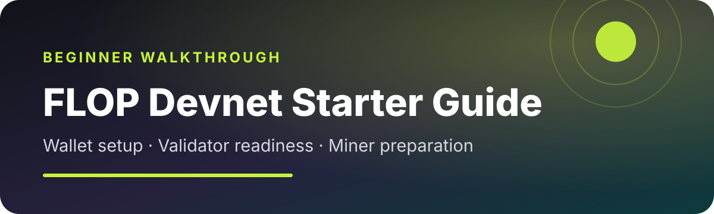
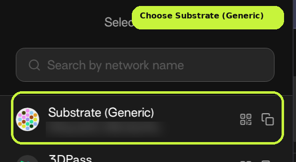
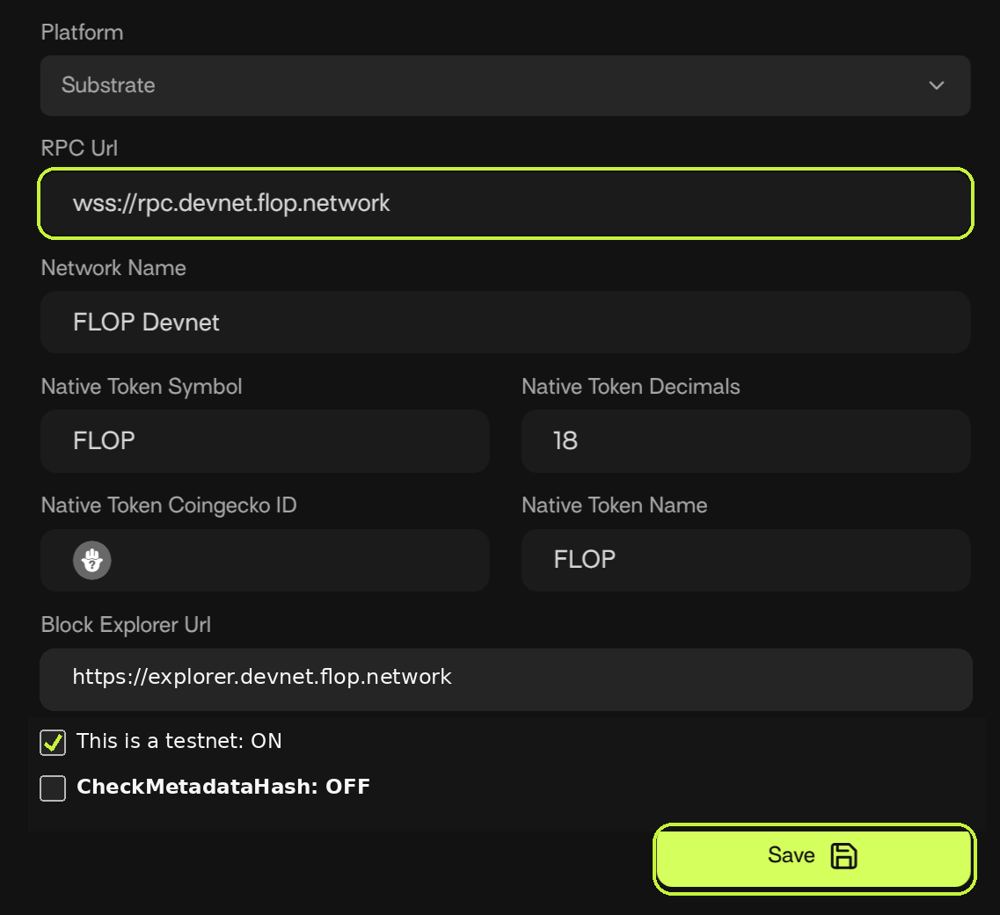
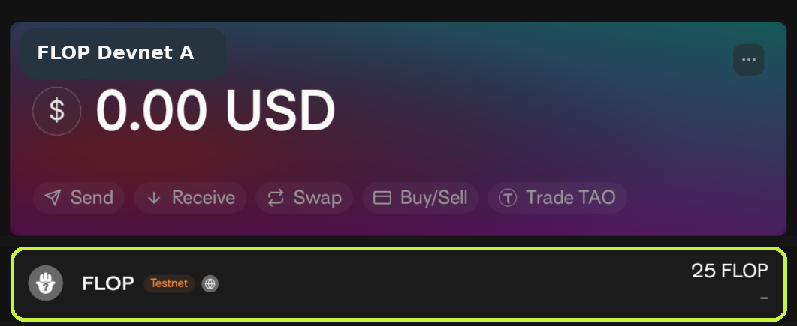
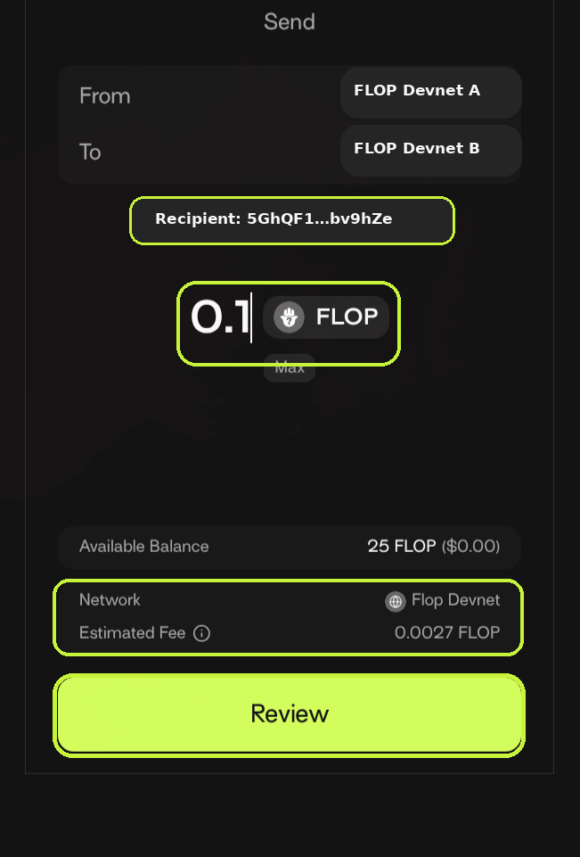

<p align="center">
  
</p>

# FLOP Devnet Starter Guide

<p align="center">
  
  
  
</p>

<p align="center">
  Set up two test accounts, claim Devnet FLOP, make one safe transfer, and understand the validator and GPU-miner paths.
</p>

---

## Before you start

**Status checked: 12 November 2026.** The official operator pages still identify the live network as Devnet. The former 3 November Testnet date was a working target, not a confirmed launch, and the public-Testnet validator profile remains unavailable.

> [!IMPORTANT]
> **FLOP Devnet is for testing only.** Devnet activity does not provide rewards, airdrop weight, scoring, or guaranteed Testnet priority.

> [!WARNING]
> There is no real, tradable, or mainnet FLOP token yet. The FLOP shown in this guide is valueless Devnet test FLOP. There is no live mint, presale, claim, official Discord, or official Telegram. Never share a recovery phrase, private key, or wallet password. Verify FLOP-specific links against [Official sources](#official-sources).

### What this guide covers

| Part | What you will do | Difficulty |
|---|---|---|
| Wallet | Install Talisman, add FLOP Devnet, claim test FLOP, and send `0.1 FLOP` to your own second account | Beginner |
| Validator | Learn the current gate and hardware expectations | Information only |
| Miner | Learn the current gate and GPU expectations | Information only |
| Testnet | Know what must be published before spending money or deploying equipment | Checklist |

### Quick navigation

- [Install Talisman](#1-install-talisman)
- [Create two test accounts](#2-create-two-test-accounts)
- [Add FLOP Devnet](#3-add-flop-devnet)
- [Claim test FLOP](#4-claim-test-flop)
- [Send FLOP to your second account](#5-send-flop-to-your-second-account)
- [Validator path](#validator-path)
- [Miner path](#miner-path)
- [Wait for Testnet](#wait-for-testnet)

---

## Wallet walkthrough

### 1. Install Talisman

Open the official Talisman download page:

**<https://talisman.xyz/download>**

1. Install the browser extension or mobile application.
2. Create a wallet and set a local password.
3. Save the recovery phrase offline.
4. Never paste the recovery phrase into a website, chat, issue, or public repository.

### 2. Create two test accounts

Create two separate **Substrate accounts inside the same disposable Talisman wallet**. You must control both accounts:

- `FLOP Devnet A`
- `FLOP Devnet B`

For each account:

1. Open the Talisman popup and select **More**.
2. Select **Add Account**.
3. Select **New Polkadot Account**. FLOP uses Substrate-style addresses.
4. Enter the account name shown above.
5. Select **Create**, then **Continue**.
6. Save and verify the recovery phrase privately if Talisman presents one.

Use disposable accounts that do not contain real assets. Never use an account containing real tokens for this test.

When Talisman asks which address to copy, select **Substrate (Generic)**.

<p align="center">
  
</p>

<p align="center"><sub>The example address is intentionally redacted.</sub></p>

### 3. Add FLOP Devnet

In Talisman:

1. Open **More**.
2. Select **Manage Networks**.
3. Select **Add Network**.
4. Choose **Substrate**.
5. Enter the settings below.

| Setting | Value |
|---|---|
| Network name | `FLOP Devnet` |
| RPC URL | `wss://rpc.devnet.flop.network` |
| Token symbol | `FLOP` |
| Token decimals | `18` |
| Token name | `FLOP` |
| Block explorer | `https://explorer.devnet.flop.network` |
| Testnet | **On** |
| CheckMetadataHash | **Off** |

<p align="center">
  
</p>

> [!NOTE]
> Keep `CheckMetadataHash` **off**. Enabling it caused Talisman to reject a live test transaction with `1011: Unknown Transaction Validity`.

Select **Save**.

### 4. Claim test FLOP

1. Open `FLOP Devnet A` in Talisman.
2. Copy its **Substrate (Generic)** address.
3. Open the official faucet: **<https://faucet.flop.network>**
4. Paste the address.
5. Request the displayed Devnet grant.
6. Wait for FLOP to appear in Talisman.

<p align="center">
  
</p>

A `$0.00` value is expected. Devnet FLOP is a test balance with no monetary value.

### 5. Send FLOP to your second account

> [!CAUTION]
> Do not use a recipient address copied from a social post or public guide. Send only to `FLOP Devnet B`, the second account you created and control.

1. Copy the **Substrate (Generic)** address for `FLOP Devnet B`.
2. Open `FLOP Devnet A`.
3. Select FLOP and choose **Send**.
4. Paste the address for `FLOP Devnet B`.
5. Enter `0.1 FLOP`.
6. Confirm the network says `FLOP Devnet`.
7. Compare the first and last six characters with the address copied from B.
8. Review the estimated fee.
9. Sign inside Talisman.

<p align="center">
  
</p>

The screenshot shows where to verify the shortened recipient address. Its middle is intentionally hidden.

Verify both accounts in the official explorer:

**<https://explorer.devnet.flop.network>**

One transfer is enough. You may send `0.05 FLOP` from B back to A as a return test, then stop. Extra transfers do not improve eligibility.

#### If Talisman reports `Unknown Transaction Validity`

1. Open the FLOP Devnet network settings.
2. Turn `CheckMetadataHash` **off**.
3. Save the network.
4. Build the transfer again.
5. Confirm completion in the explorer.

---

## Validator path

FLOP validators participate in block production, finality, and data availability. A validator does not need a GPU.

### Current status

The current Devnet validator process is administrator-assisted. It requires FLOP operations coordination, network enrollment, funding, private peer information, and promotion. Public-Testnet self-service onboarding remains unavailable.

### Planning profile

- 8 dedicated CPU cores
- 32 GB RAM
- 4 TB NVMe storage
- Reliable low-latency 1 Gbps internet
- Continuous monitoring, backups, and uptime

### Recommended action

**Prepare, but do not deploy yet.** Read the current [official validator guide](https://docs.flop.network/docs/run-validator) and wait for published public-Testnet network identity and onboarding. Do not copy development keys, expose unsafe RPC ports, or attempt to bypass admission.

---

## Miner path

FLOP miners use NVIDIA GPUs to serve AI inference. The worker also handles registration, calibration, evidence, and sessions.

### Current status

The official miner guide still labels availability as **Devnet development only**, but its public manual pack is available now and no invitation is required. At the status check above, automatic Devnet sponsorship was open. An experienced operator can use the public pack to sponsor, register, run, and calibrate a Devnet miner through public endpoints.

Paid public work and complete outside-gateway admission remain gated. A healthy container, loaded model, registration, or calibration does not by itself prove paid-session acceptance or earnings.

### Documented starting point

- Linux host or full virtual machine
- NVIDIA GPU with enough VRAM for the exact registered model
- Docker and NVIDIA Container Toolkit
- Persistent model storage
- Public HTTPS hostname or controlled HTTPS tunnel

### Recommended action

**Beginners should stop at the host checks.** Experienced operators can follow the current public Devnet pack to test sponsorship, registration, and calibration now, while keeping all keys and tokens on the host. Before paying for hardware or expecting work, confirm current sponsorship capacity, model requirements, admission gates, paid-session availability, and final participation rules.

Read the [official miner guide](https://docs.flop.network/docs/run-miner) for the latest status.

---

## Wait for Testnet

Devnet earns nothing and does not qualify an account for future rewards.

The official timeline page still shows 3 November 2026 as a **working target**, but that date has passed without the operator pages switching from Devnet to a confirmed public Testnet. Wait for a fresh announcement from `@flop_labs` and published Testnet network identity before participating.

Before spending money or deploying equipment, wait for FLOP to publish:

- A confirmed live Testnet announcement
- Testnet genesis and network settings
- Final validator and miner releases
- Public onboarding rules
- Final scoring, reward, snapshot, and vesting rules
- Supported hardware and models

The published draft Testnet design focuses on actual usage and verified compute—not transfer spam, wallet balances, completed-job counts, or active days. Draft rules can change before launch.

---

## Official sources

- [Talisman wallet download](https://talisman.xyz/download)
- [FLOP on X](https://x.com/flop_labs)
- [FLOP documentation](https://docs.flop.network)
- [FLOP GitHub](https://github.com/flop-labs)
- [FLOP website](https://flop.finance)
- [Official links and verification](https://docs.flop.network/docs/official-links)
- [Testnet and launch timeline](https://docs.flop.network/docs/testnet-and-timeline)
- [Draft airdrop and Testnet conversion design](https://docs.flop.network/docs/airdrop-and-testnet-conversion)
- [Validator guide](https://docs.flop.network/docs/run-validator)
- [Miner guide](https://docs.flop.network/docs/run-miner)
- [Devnet faucet](https://faucet.flop.network)
- [Devnet explorer](https://explorer.devnet.flop.network)

---

<details>
<summary><strong>Optional technical checks</strong></summary>

The `scripts/` directory contains two read-only checks for experienced operators:

```bash
python3 scripts/check-devnet.py
bash scripts/check-miner-host.sh
```

Beginners do not need these scripts for the wallet walkthrough. Neither script creates keys, sends transactions, registers an operator, or starts a persistent service.

</details>

## Contributing

Found an outdated screen or changed FLOP setting? Open an issue with the official source and the exact step that needs updating. Never include wallet secrets, private keys, passwords, or session tokens.

## License

MIT
